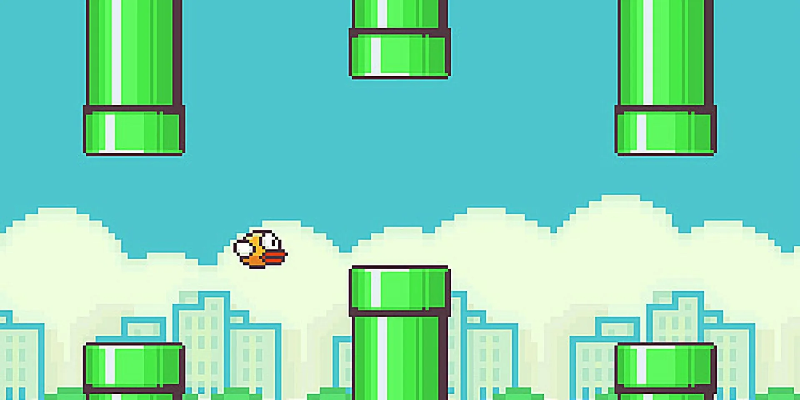

# VAHO - Una historia al otro lado del vidrio

Integrantes: 

*Isidora Pérez*

```Vaho``` es una experiencia web táctil y sonora que nace del recuerdo de empañar un vidrio y dibujar o contar una historia sobre él durante un día de lluvia. Su nombre hace referencia al vapor que despiden los cuerpos en determinadas condiciones de temperatura y humedad, capaz de formar una capa que oculta lo que se encuentra al otro lado.

El proyecto es capaz de retomar ese gesto de la infancia para construir una historia ficticia detrás de este. La ventana empañada se convierte en la entrada a un mundo nuevo por descubrir. Cada recorrido realizado con las manos deja una huella y revela parte de la historia y paisaje que se encuentra detrás.

Vaho busca recuperar la curiosidad de mirar a través  de una ventana y transformar lo que vemos a través del tacto, invitando a tocar, escuchar e imaginar lo que ocurre al otro lado.

## Concepto

En **Vaho**, deslizar el dedo sobre el teléfono despeja una ventana empañada en el computador y hace audible el roce del gesto. El paisaje se descubre por partes, siguiendo el recorrido de la mano. Cuando la mano se detiene, la huella queda visible y el sonido se atenúa. La posición del dedo determina dónde se abre el vidrio y el sonido acompaña el momento en que se mueve. Una vez descubierto el bosque, la mano pasa de revelar el lugar a recorrerlo. Al final, el vaho vuelve a cubrir la imagen y la aventura puede empezar otra vez.

La propuesta busca que tocar, ver y oír se perciban como partes de una misma acción. Aunque las pantallas están separadas, la posición del dedo encuentra una respuesta visible en el paisaje. Una vez descubierto el bosque, el contacto se transforma en una aventura. La misma mano permite saltar, esquivar, volar y subir una torre.

## ¿Cómo funciona?

Este juego de interacción se compone de distintas fases, las cuales son:

1. ```Pantalla inicial:``` Al deslizar y desplazar el dedo mediante la pantalla de teléfono se despeja este paisaje en donde se basa toda el juego e historia. Se necesita un 80% de la pantalla despejada para poder visualizar la primera etapa del juego.
2. ```Empezar aventura:``` Al despejar toda la pantalla de este vaho tenemos este botón, donde al oprimirlo, se visualiza la cuenta regresiva de la primera etapa, donde este personaje avanza de manera automática por la pantalla, a su vez en el teléfono se visualizarán dos botones (arriba - abajo), los cuales se presionan según el obstáculo que tiene que pasar el personaje, como lo son saltar troncos y agacharse para esquivar las ramas hasta llegar a la puerta final.
3. ```Segunda etapa:``` Al llegar a la puerta final de la 1ra etapa, se pasará a la 2da etapa oprimiendo botón, donde esta consiste en pasar diez pares de tubos al ir pulsando el teléfono.
4. ```Tercera etapa:``` Luego de finalizar la 2da etapa, se inicia la 3ra etapa, la cual al deslizar el dedo por la pantalla el personaje esquivará las rocas para seguir el camino.
5. ```Etapa final:``` El último tramo es ya llegando a la meta, donde al deslizar el dedo por la pantalla del teléfono, este personaje se moverá llegando como límite la escalera, donde se tendrá que deslizar el dedo hacia arriba y llegar a la torre donde se encuentra la princesa. Al terminar esta etapa, se reinicia el juego y se vuelve a contar esta historia volviendo al vaho.
   
Los 3 juegos inician con 3 vidas cada uno. Si estas se agotan, la opción de "reiniciar etapa" permite repetirla.

## Conexiones

| Momento | Gesto o entrada | Respuesta visual | Respuesta sonora |
|---|---|---|---|
| Despeje | Deslizar el dedo. La posición X/Y ubica el contacto. | Se abre una huella que sigue el recorrido y aumenta el porcentaje despejado. | El roce sube de volumen con el movimiento y se atenúa al parar. |
| Interfaz | Posición dedo, deslizamiento y toque breve. | El puntero señala un botón y el toque lo activa. | Clic. |
| Inicio de la etapa 1 | Pulsar **Empezar aventura** en el teléfono. | Aparece la cuenta regresiva. | Suenan el clic y el audio del **3, 2, 1**. |
| Etapa 1 | Deslizar hacia arriba o hacia abajo en el teléfono. | El personaje salta o se agacha. | Cada acción tiene su propio efecto y sonido. |
| Etapa 2 | Pulsar el escenario. | El personaje gana altura para pasar entre los tubos. | Suena un impulso en cada pulsación. |
| Etapa 3 | Deslizar a izquierda o derecha. | El personaje cambia de carril para esquivar rocas. | Suena un deslizamiento al cambiar de carril. |
| Etapa 4 | Deslizar a la derecha y luego hacia arriba. | La distancia del gesto hace avanzar al personaje hasta la escalera y después hacia la cima. | Suenan pasos mientras hay movimiento y deslizamiento. |
| Encuentro | Completar el último deslizamiento hacia arriba. | Aparecen corazones y, unos segundos después, vuelve el vaho. | Suena un beso en el encuentro final de los personajes. |

> El clic de la interfaz se reproduce en el dispositivo donde se pulsa el botón, cuando el sonido está activo. La presión, el diámetro del contacto y el giro del teléfono quedan fuera de las conexiones de esta versión.

## Conectar el teléfono por MQTT

1. Abre Vaho en el computador y pulsa **Activar sonido** (también se puede realizar desde el teléfono).
2. Pulsa **Conectar teléfono** y abre el enlace generado en el navegador del teléfono. El código de sala va incluido.
3. En el teléfono, pulsa **Conectar**. Cuando indique que está conectado, desliza sobre su superficie táctil y mira el resultado en el computador.
   
### Mandos

Desliza sobre el mando para mover el punto del computador. Durante el despeje, la zona táctil corresponde directamente al vidrio. 
- Pulsa **Mover punto** en el teléfono para recorrer la página
- Pulsa **Volver a despejar** para regresar al vidrio. 

## Sonidos

El proyecto usa 9 archivos de audio extraídos de 

<https://www.myinstants.com/es/index/cl/>

<https://pixabay.com/es/> 

| Archivo | Uso | Autoría, origen y licencia |
|---|---|---|
| `despejar.mp3` | Roce al despejar el vidrio | <https://www.myinstants.com/es/instant/minecraft-xp-sound-1-30960/> |
| `salto.mp3` | Salto sobre troncos | <https://pixabay.com/es/sound-effects/search/salto%20de%20videojuego/> |
| `agacharse.mp3` | Agacharse bajo ramas | <https://pixabay.com/es/sound-effects/search/agacharse/?pagi=3> |
| `salto-etapa-2.mp3` | Impulso durante el vuelo | <https://pixabay.com/es/sound-effects/search/salto/> |
| `deslizar.mp3` | Cambio de carril | <https://pixabay.com/es/sound-effects/search/movimiento%20del%20juego/> |
| `caminar.mp3` | Pasos y ascenso por la escalera | <https://pixabay.com/es/sound-effects/search/walking%20game/> |
| `besos.mp3` | Encuentro en la torre | <https://www.myinstants.com/es/instant/besos-79164/> |
| `click.mp3` | Pulsación de botones | <https://pixabay.com/es/sound-effects/search/menu-click/> |
| `cuenta-regresiva.mp3` | Inicio de la primera etapa | <https://pixabay.com/es/sound-effects/search/cuenta%20regresiva/> |

## Visualidad

El nombre del proyecto alude al empañamiento que se genera en los vidrios. 

La gráfica de la interfaz combina un bosque en pixel art, inspirado en el juego ```Terraria```. La tipografía ```ARCADECLASSIC``` del título y de los botones principales acompaña la estética arcade, mientras que ```Roboto Mono``` se usa para las instrucciones y los controles.


La gama de colores de la interfaz como lo son el cielo celeste, los verdes del bosque, los tonos de madera y arena toman como referencia la paleta de ```Animal Crossing```. El escenario ocupa el centro de la página y el teléfono muestra el control que corresponde a cada etapa.


Además el ```Flappy bird``` se ve proyectado en una de las etapas como un referente principal.



## Reflexión

Durante el desarrollo del proyecto la respuesta del sistema de forma automática era una parte importante y vital de la interfaz. Si el puntero o sonido llegaban tarde, no se llegaba a una buena relación con el gesto mostrado en la visualización, lo cual costaba hacer una relación con el gesto.  

También se vió la diferencia entre tocar y dejar el rastro, ya que la posición del dedo es la que define en dónde o desde dónde se despeja, mientras que el movimiento determina la acción o cuándo se escucha. Esta separación permite reconocer acción y su consecuencia.

Lo que queda fuera es la sensación física de tocar vidrio húmedo. La pantalla no reproduce su temperatura ni su resistencia, y la presión del dedo no cambia el resultado. La sensación de contacto depende de que la huella y el audio respondan a tiempo. El juego explora otra relación con el mismo paisaje. 

> Mejoras para una próxima versión:

1. Nuevos niveles o etapas: Al principio quería realizar distintos escenarios dentro del juego, no los pude realizar debido a que me quise enfocar en uno y realizar sus etapas, para así realizarlo de forma más completa.
2. Velocidad puntero: Aumentar la velocidad de este y que sea más fluida.
3. Implementar giroscopio: Me gustaría ir más allá con el juego y no que solo sea deslizamiento mediante las manos, si no que también quizá al mover el teléfono se pueda manejar el juego. Sin necesidad de deslizar.


